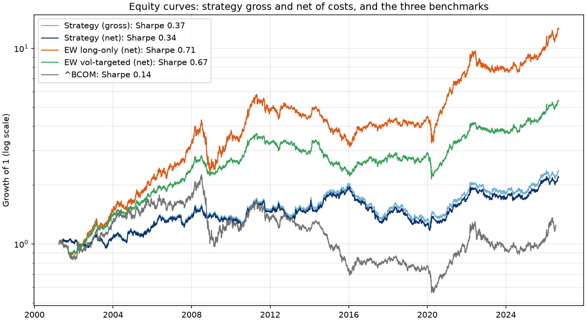
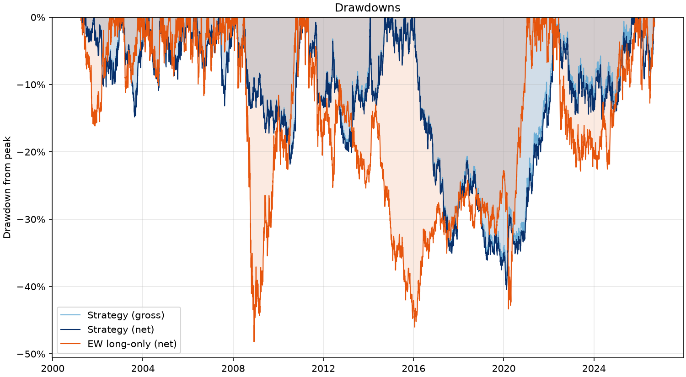
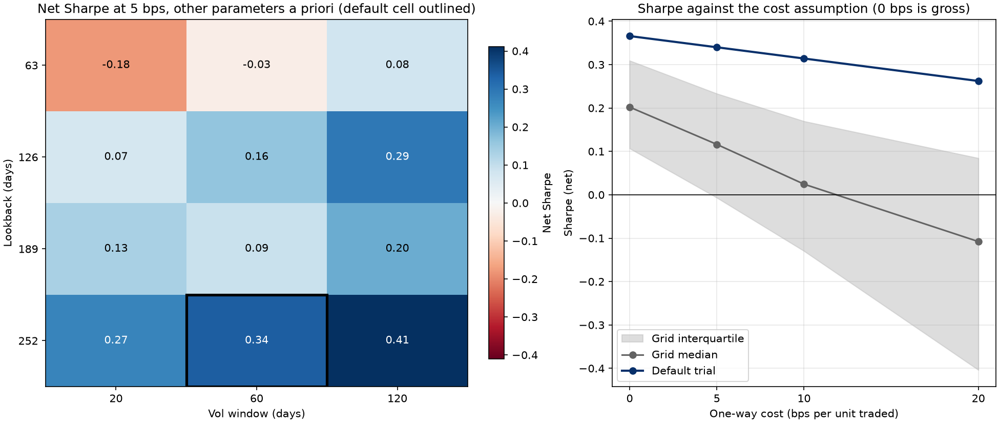
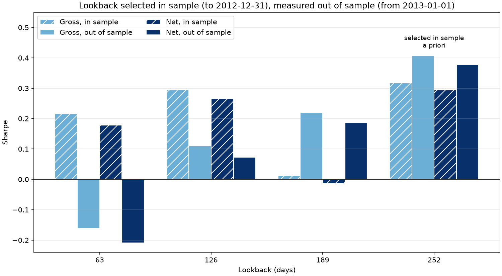
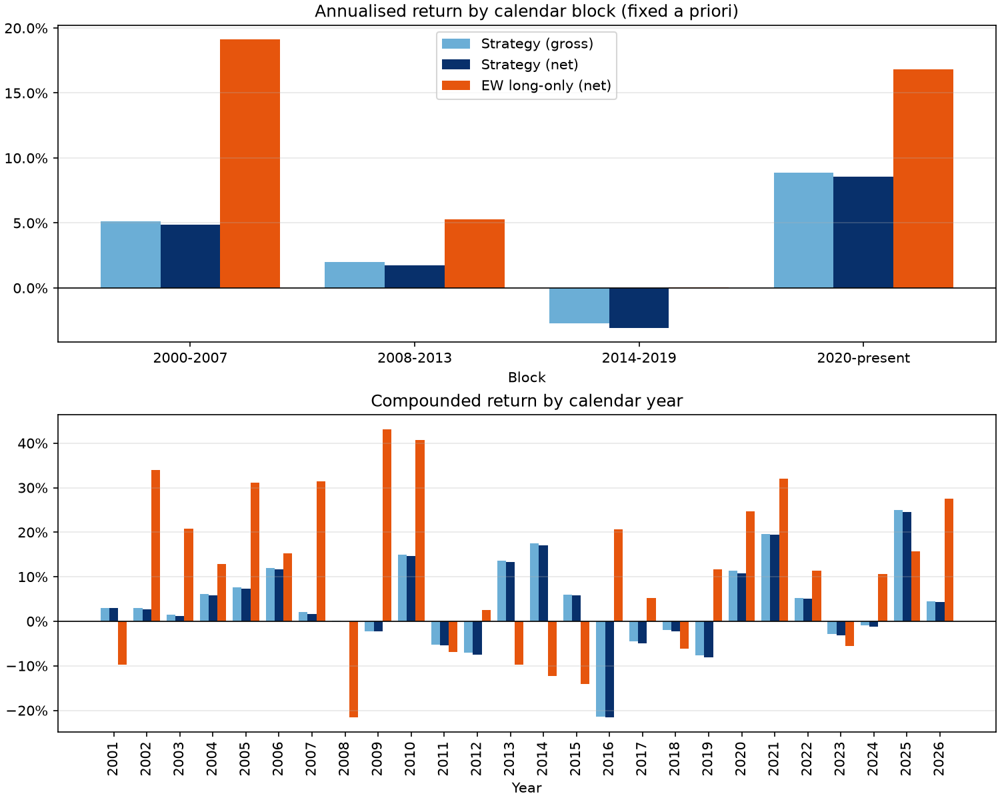
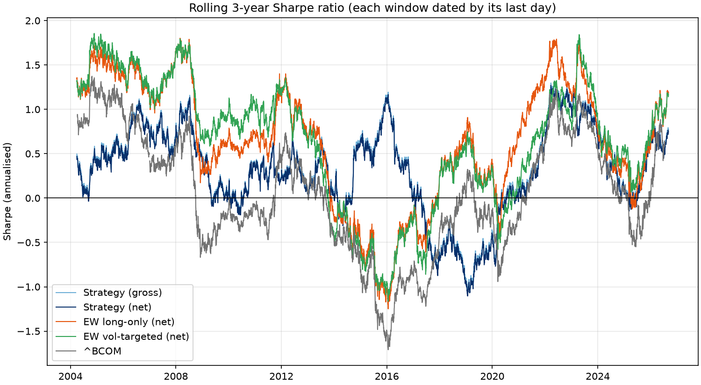

# Commodity Futures Time-Series Momentum

[](https://github.com/Jesstran12/Project-2-Multi-Basket-TSMOM-Strategy-Portfolio-Risk-Threshold-Model/actions/workflows/ci.yml)

A rules-based long/short trend-following strategy on a basket of liquid commodity futures,
backtested the way a systematic desk would review it: lookahead-free, gross and net of costs,
volatility-targeted, benchmarked, with parameter sensitivity and an explicit overfitting
discussion.

In one breath: a twelve-month trend signal on thirteen commodity futures, volatility-targeted
to ten percent, rebalanced monthly with a one-day lag and five basis points of cost, shown
gross and net against three benchmarks, with lookahead tests, a 192-trial sensitivity grid, a
Deflated Sharpe Ratio, and an in-sample/out-of-sample exercise that shows what tuning would
have cost.

> Status: `v1.0`. All eight phases are done (data panel, signal, position sizing, backtest
> engine with costs and benchmarks, metrics and inference, robustness, figures, write-up).
> The price snapshot is committed under `data/`, every results file under `results/` and the
> figures under `figures/`, all regenerated by `make all` from the snapshot in about 15
> seconds. `PROJECT_LOG.md` holds the full design, the feature log and the decision log;
> `SETUP.md` gets a fresh machine to a green test suite;
> `notebooks/strategy.ipynb` walks the results.

## The signal

For each instrument, compare today's price with its price 12 months (252 trading days) ago.
If it is higher, go long; if lower, go short. Re-evaluate on the last trading day of each
month. Positions are scaled so each instrument contributes similar risk, then the whole
portfolio is scaled to a 10% annualised volatility target with a 3x gross leverage cap.
This is plain time-series momentum (TSMOM) as documented by Moskowitz, Ooi and Pedersen
(2012), with no parameters chosen by looking at this dataset.

## Why it might work

Three textbook mechanisms make the bet plausible rather than a coin flip:

- **Slow information diffusion.** News is absorbed gradually, so prices drift rather than jump.
- **Under- and over-reaction.** Investors anchor early in a trend and herd late in it.
- **Hedging pressure.** Commodity producers and consumers hedge, and pay speculators a premium to take the other side. That premium persists and tends to sit with the trend.

None of these is a guarantee. The point of this project is to test an off-the-shelf version of
the idea honestly, not to find the best-performing variant.

## The short answer

Over April 2001 to September 2026 the strategy made 3.14% a year net of costs at 10.82%
volatility, a net Sharpe ratio of 0.34 (0.37 gross), with a worst drawdown of -40.42%. That is
positive, it survived its own costs, and it held up out of sample. It is not a strong result:
the Sharpe's 95% bootstrap interval runs from -0.04 to 0.72, and once the 192 configurations
evaluated in the robustness grid are accounted for, the Deflated Sharpe Ratio is 0.324, which
says the result is not distinguishable from the best of 192 lucky draws. The equal-weight
long-only basket of the same futures did better (Sharpe 0.71), for a reason the data cannot
hide: the free front-month series never pay the cost of rolling contracts, which flatters any
long position. An investable index that does roll, the Bloomberg Commodity Index, made 0.88% a
year (Sharpe 0.14) over the same window. The rest of this document shows the evidence for each
of those sentences.

## Method

**Data.** Daily front-month settlement prices from Yahoo Finance for 14 candidate futures
across energy, metals, grains, softs and livestock, pulled once on 2026-09-08 (yfinance 1.7.0)
and committed under `data/` with a manifest of SHA-256 hashes, so every number below is tied
to that snapshot. Prices are aligned on the union calendar (7,268 trading days from
1997-10-29 to 2026-09-07) and gaps of up to 5 days are forward-filled with a zero return;
longer gaps stay missing. Daily returns are `(P(t) - P(t-1)) / |P(t-1)|`, so the negative WTI
settlement of 2020-04-20 produces a finite number, and are clipped to ±50%: exactly two
observations were clipped, both WTI (2020-04-20 at -306% and 2020-04-21 at +127%), and both
are listed in `results/data_quality.md`. A quality gate (at least 10 years of history, at most
5% of days filled, no gap longer than 20 days) excludes platinum for a 53-day gap, leaving 13
instruments. Each enters the portfolio on its own first valid signal, so the early years run
with fewer names (12.8 live on average over the strategy's life).

**Signal.** The 252-day trailing return on a price index rebuilt from the cleaned returns, so
the signal and the P&L see the same series. Its sign is the position: +1, -1, or 0 on a tie.
No skip month. A 21-day skip, and lookbacks of 63, 126 and 189 days, are robustness variants
and nothing else.

**Sizing.** Two stages. Each instrument is scaled to a 10% annualised volatility (60-day
rolling standard deviation) and divided by the number of live instruments; then the whole book
is scaled so the portfolio's own trailing 60-day volatility is 10%. Gross leverage is capped
at 3x. On this panel the cap never binds: the maximum gross leverage over the life is 2.23x
and the average 1.10x, both in `results/backtest.md`.

**Execution and costs.** Weights are recomputed on the last trading day of each month (321
rebalance dates) and held constant in weight terms until the next; positions are the weights
shifted by one day, so a weight formed at the close of `t` earns the return from `t` to
`t+1`. Turnover is the sum of absolute position changes, charged at 5 basis points one way.
Over 25 years that cost 7.1 percentage points of cumulative return, or 0.29% a year, on an
annual turnover of 5.59x. Roll costs are not modelled, because roll dates are not observable in
the data.

**Benchmarks.** Three, all on the same calendar: the equal-weight long-only basket of the same
13 instruments with the same cost model; the same basket volatility-targeted to 10% with the
strategy's own portfolio scaling (so the comparison is not about leverage); and `^BCOM`, the
Bloomberg Commodity Index, which rolls its contracts and ends 36 trading days before the
snapshot.

**Metrics and inference.** Everything is computed on daily returns with a zero risk-free rate.
The Sharpe t-statistic, a 95% stationary block bootstrap interval (block length 20, 2,000
resamples, fixed seed), the Probabilistic Sharpe Ratio against zero, and the Deflated Sharpe
Ratio of Bailey and López de Prado with the trial count taken from the robustness grid.

All parameters live in `config/default.yaml` and were fixed before any backtest ran; every run
writes the resolved configuration beside its outputs.

## Results

The table below is `results/metrics_table.md`, injected verbatim by `make report`; the five
columns are the strategy gross and net of costs and the three benchmarks.

<!-- METRICS:START -->
| Metric | Strategy (gross) | Strategy (net) | EW long-only (net) | EW vol-targeted (net) | ^BCOM |
|---|---:|---:|---:|---:|---:|
| Annualised return | 3.43% | 3.14% | 10.48% | 6.85% | 0.88% |
| Annualised volatility | 10.82% | 10.82% | 15.70% | 10.66% | 16.21% |
| Sharpe ratio | 0.37 | 0.34 | 0.71 | 0.67 | 0.14 |
| Sortino ratio | 0.52 | 0.48 | 1.02 | 0.96 | 0.19 |
| Max drawdown | -39.46% | -40.42% | -48.19% | -41.32% | -75.00% |
| Max drawdown duration (days) | 1562 | 2442 | 2445 | 2700 | 4534 |
| Calmar ratio | 0.09 | 0.08 | 0.22 | 0.17 | 0.01 |
| Hit rate (daily) | 51.58% | 51.51% | 53.01% | 53.01% | 51.54% |
| Hit rate (monthly) | 53.27% | 52.29% | 59.48% | 59.80% | 52.63% |
| Skew | -0.11 | -0.11 | -0.15 | -0.22 | -0.27 |
| Excess kurtosis | 2.25 | 2.25 | 2.88 | 2.12 | 2.68 |
| Best month | 11.42% | 11.39% | 14.16% | 9.16% | 12.99% |
| Worst month | -11.76% | -11.77% | -18.24% | -11.54% | -21.34% |
| Turnover (x per year) | 5.59 | 5.59 | 0.02 | 0.91 | n/a |
| Average gross leverage | 1.10 | 1.10 | 1.00 | 0.74 | n/a |
| Leverage cap binds (share of days) | 0.00% | 0.00% | n/a | 0.00% | n/a |
| Average instruments live | 12.80 | 12.80 | 13.00 | 13.00 | n/a |
| Sharpe t-statistic | 1.85 | 1.71 | 3.60 | 3.40 | 0.68 |
| Sharpe CI low (bootstrap) | -0.01 | -0.04 | 0.31 | 0.25 | -0.27 |
| Sharpe CI high (bootstrap) | 0.74 | 0.72 | 1.13 | 1.11 | 0.55 |
| Probabilistic Sharpe (vs 0) | 0.967 | 0.957 | 1.000 | 1.000 | 0.751 |
| Trials counted | 192 | 192 | 1 | 1 | 1 |
| Sharpe hurdle (DSR) | 0.43 | 0.43 | 0.00 | 0.00 | 0.00 |
| Deflated Sharpe | 0.372 | 0.324 | 1.000 | 1.000 | 0.751 |
| Days | 6410 | 6410 | 6410 | 6410 | 6356 |
| First day | 2001-04-02 | 2001-04-02 | 2001-04-02 | 2001-04-02 | 2001-04-02 |
| Last day | 2026-09-07 | 2026-09-07 | 2026-09-07 | 2026-09-07 | 2026-07-17 |
<!-- METRICS:END -->





Three things to read off the table and the two figures:

- **The strategy did what it was built to do.** Realised volatility is 10.82% against a 10%
  target, the leverage cap never bound, and the net line sits just under the gross line
  everywhere: costs took 0.03 of Sharpe. The drawdown profile is long and shallow rather than
  sharp: the worst net drawdown, -40.42%, took 2,442 trading days (about ten years) from peak
  to recovery, and the single worst month was -11.77%.
- **The long-only basket beat it, and that is partly an artefact.** The basket's 10.48% a year
  comes from unadjusted front-month series that track the spot price and never pay the roll.
  The index that does roll made 0.88% a year with a -75.00% drawdown. The strategy is short
  about half the time, so it is flattered less by this than the basket is; a fair comparison
  needs back-adjusted data, which the free source does not provide (see Limitations).
- **The vol-targeted basket is the sharper benchmark.** At the same 10% target it made 6.85% a
  year (Sharpe 0.67) with a -41.32% drawdown, so on this data a trend signal did not beat
  simply owning the basket at the same risk. The strategy's edge, if it has one, is in its
  crisis behaviour, discussed under sub-periods below.

## Robustness

Every number in this section comes from `results/sweeps.md`, `results/is_oos.md` and
`results/subperiods.md`, each regenerated by `make all`.

**The grid: 192 configurations.** Lookback {63, 126, 189, 252} x vol window {20, 60, 120} x
estimator {rolling, EWMA} x rebalance {monthly, daily} x skip {0, 21} x lag {1, 2}, each at
costs of 0, 5, 10 and 20 bps. Every configuration counts as a trial for the Deflated Sharpe
Ratio, whether or not it was ever looked at. At 5 bps the 192 net Sharpe ratios range from
-0.29 to 0.47 with a median of 0.12; 74.5% are positive. The a-priori default, 0.34, ranks 12th
of 192. The best trial (0.47) is the default with a 120-day vol window and daily rebalancing;
the worst (-0.29) is a 63-day lookback with a 20-day vol window and a two-day lag.



**Lookback and vol window.** In the heatmap (the other four parameters at their defaults) the
252-day row reads 0.27, 0.34 and 0.41 across vol windows of 20, 60 and 120 days: the longest
lookback is the best row, and a longer vol window helps. The 63-day row is negative at every
window. The result is a property of twelve-month trend, not of a tuned cell.

**Costs.** The right panel sweeps the cost assumption. The default trial's Sharpe falls from
0.37 at zero cost to 0.34 at 5 bps, 0.31 at 10 bps and 0.26 at 20 bps; the grid median crosses
zero between 10 and 20 bps, and the share of positive trials falls from 96% to 36%. A monthly
twelve-month signal is cheap to trade; most of the grid is not.

**Execution lag.** Moving the lag from one day to two takes the net Sharpe from 0.34 to 0.28
(gross 0.37 to 0.31), a measure of how much the "trade at the signal's own close" convention
is worth.

**In sample versus out of sample.** The lookback, and only the lookback, is selected on net
Sharpe over the in-sample window (each trial's life up to 2012-12-31), then measured out of
sample from 2013-01-01. The selection picks 252, the a-priori value, so on this panel the
exercise would have cost nothing: the out-of-sample Sharpe of the selected lookback is 0.38, the
same as the default's. The exercise still shows the risk of selecting: the 63-day lookback,
0.18 in sample, is -0.21 out of sample, and the 126-day one falls from 0.27 to 0.07. The
in-sample statistics are computed blind to the out-of-sample returns, and a test proves it.



**Sub-periods.** By fixed calendar block the net Sharpe is 0.52 (2001 to 2007), 0.21 (2008 to
2013), -0.23 (2014 to 2019) and 0.80 (2020 to date); the long-only basket's are 1.32, 0.36,
0.06 and 1.04. Of 26 calendar years, 16 were positive net; the best was 2025 at +24.60% and the
worst 2016 at -21.62%, the year the 2014 to 2016 commodity bear market reversed. The rolling
three-year net Sharpe is positive in 78.7% of windows, with a minimum of -1.10 in the window
ending 2019-01-24 and a maximum of 1.27 in the window ending 2022-03-23.





**Calm and stress, with a hindsight caveat.** Labelling a day "stress" when the basket's
trailing 60-day volatility is above its full-sample 75th percentile (a threshold known only
once the sample had ended, so this is a description, not a tradable rule): the strategy made
6.06% a year (Sharpe 0.60) on the 76% of calm days and lost 5.54% a year (Sharpe -0.48) on the
24% of stress days, while the basket made 12.58% and 4.10%. This strategy did not earn its
keep in commodity crises, which is the opposite of the "crisis alpha" trend-following is often
sold on. With monthly rebalancing and a twelve-month lookback it is slow to turn, and 2020 and
2022 both reversed inside a month.

**Exposure.** Gross and net leverage and the long and short counts over the life are in
`figures/exposure.png`; the book is net long about as often as net short.

## Inference

Net of costs, the strategy's Sharpe ratio of 0.34 has a t-statistic of 1.71 over 6,410 days,
a 95% block-bootstrap interval of -0.04 to 0.72, and a Probabilistic Sharpe Ratio of 0.957:
there is a 95.7% chance the true Sharpe is above zero, if this were the only strategy tested.

It was not. 192 configurations were evaluated in the grid. Under the Bailey and López de Prado
correction, the expected maximum Sharpe of 192 zero-skill variants whose Sharpe ratios have the
spread seen in the grid (a standard deviation of 0.156) is 0.43. That is the hurdle. The
default's 0.34 is below it, and the Deflated Sharpe Ratio is 0.324 net (0.372 gross): a 32%
chance the result beats the luckiest of 192 null strategies. In plain words, the result cannot
be distinguished from selection luck, even though the default was fixed before the grid was
run and the grid was built to test it, not to find it.

What the in-sample selection would have cost is the other half of the overfitting question,
and here the answer is nothing, by coincidence: the in-sample winner is the a-priori lookback.
Had the exercise picked the second-best in-sample lookback, 126 days, the out-of-sample Sharpe
would have been 0.07 instead of 0.38. The honest summary is that twelve-month commodity trend
delivered a small positive Sharpe net of costs over 25 years, that this is consistent with the
published literature and not with a dataset-specific discovery, and that the evidence from this
one basket is too weak to reject luck.

## Limitations

- **Roll gaps.** The series are unadjusted front-month settlements. When the front contract
  rolls, the price jumps by the spread between the two contracts, which the returns treat as a
  real move. The roll yield, positive or negative, is therefore not paid, which flatters long
  positions in markets that were in contango for most of this sample. This is why the
  long-only basket shows 10.48% a year while the rolling index shows 0.88%. A back-adjusted
  continuous series from a paid vendor can be dropped in through the `CSVSource` loader in
  `src/data.py` without touching the engine.
- **Negative prices and the clipping rule.** The WTI settlement of -$37.63 on 2020-04-20 is
  handled by dividing price changes by the absolute previous price and clipping every daily
  return to ±50%. Two observations were clipped, both logged. The rule also tames roll gaps and
  bad prints, at the cost of understating the two most extreme days in the sample.
- **Gap filling.** Gaps of up to 5 days are forward-filled with a zero return (0.21% to 0.54%
  of each instrument's days); longer gaps stay missing and the instrument drops out until data
  resumes. One 20-day live cattle gap passes the quality gate but exceeds the fill limit, so 20
  instrument-days carry a position but no return.
- **Universe choice.** The 14 candidates were chosen knowing these markets exist and are liquid
  today. Within the basket there is no survivorship bias, because the universe was fixed
  before any backtest and the gate excluded platinum on data quality alone, but a desk in 2001
  would not have known which contracts would stay liquid.
- **Execution.** No intraday data, no bid/ask spread, no margin or financing: the 5 bps cost is
  a flat one-way charge per unit of notional traded, the same for crude oil and live cattle.
  Trading at the same close the signal was computed on is slightly optimistic; the two-day lag
  shows what one more day costs. Weights are held constant between rebalances rather than
  drifting with price.
- **The external benchmark.** `^BCOM` has 18 missing prints inside the window and ends on
  2026-07-17, 36 trading days before the snapshot; its statistics are over its own 6,356 days.
- **One snapshot.** Yahoo Finance revises history. The committed snapshot, its manifest and
  `make data` (the only command that touches the network) make the numbers reproducible, not
  permanent.

## Reproduce

First-time setup is in `SETUP.md`. Day to day:

```
make setup        # create the environment with uv
make lint test    # ruff + pytest
make all          # panel -> backtest -> benchmarks -> metrics -> robustness -> figures -> report
make notebook     # execute notebooks/strategy.ipynb headless
```

`make all` reads the committed snapshot in `data/`, rewrites `results/` and `figures/`, and
injects the metrics table into this file; two runs produce byte-identical files. Only
`make data` touches the network. The robustness grid is cached in `results/grid.parquet`,
keyed by a fingerprint of the configuration and the data, so a changed parameter re-runs only
the trials it affects; delete the cache after a code change.

## Rigor checklist

Each item names the code and the test that proves it; `uv run pytest -k Integrity -vv` lists
the integrity tests by name.

1. **No lookahead.** Every rolling stage has a perturbation test through
   `tests/integrity.py::assert_no_lookahead`: prices after `t` are replaced by noise and every
   value at or before `t` must be bit-identical. Applied to the signal
   (`tests/test_signals.py::TestIntegrityNoLookahead`), the vol estimates, raw weights and
   sized weights (`tests/test_portfolio.py::TestIntegrityNoLookahead`), the positions and
   gross and net returns (`tests/test_backtest.py`, `test_positions_have_no_lookahead` and
   `test_net_returns_have_no_lookahead_on_the_snapshot`), the benchmarks
   (`tests/test_benchmark.py`), the rolling Sharpe (`tests/test_subperiods.py`) and the
   in-sample selection (`tests/test_robustness.py::TestIntegrityIsOosSelection`).
2. **Costs applied; every result gross and net.** `src/backtest.py` charges turnover at the
   configured rate; `tests/test_backtest.py` checks a unit flip costs exactly `2 * bps / 1e4`
   and that net equals gross minus cost on every row. Every table and figure of strategy
   returns carries both series, enforced by `tests/test_readme.py` and `tests/test_plots.py`.
3. **Two-stage vol targeting with a leverage cap.** `src/portfolio.py` scales per asset, then
   the book, then clips gross leverage at 3x; `tests/test_portfolio.py` checks the realised
   volatility of a synthetic book lands on target (`TestIntegrityVolTargeting`), the cap
   arithmetic (`TestLeverageCap`) and that gross leverage never exceeds the cap on the
   snapshot. The cap-binding share (0.00%) is in the table and `results/backtest.md`.
4. **Walk-forward.** Every parameter is the a-priori default in `config/default.yaml`; the only
   selection is the lookback in `src/robustness.py` (`is_oos`), reported with its out-of-sample
   Sharpe and degradation in `results/is_oos.md` and `figures/is_oos.png`, and
   `tests/test_robustness.py` proves the in-sample numbers are blind to out-of-sample returns.
5. **Sensitivity grid, trial count, DSR.** The 192-trial grid is `src/robustness.py`
   (`grid_specs`), counted by `tests/test_robustness.py` and `tests/test_cli.py`
   (`test_the_full_grid_is_192_trials_at_four_costs`, `test_trials_and_the_deflated_sharpe`);
   the Deflated Sharpe Ratio is `src/inference.py` (`deflated_sharpe`), checked against
   hand-computed cases in `tests/test_inference.py`; the results are in `results/sweeps.md` and
   `figures/param_sensitivity.png`.
6. **Benchmarked.** `src/benchmark.py` builds the equal-weight long-only basket, the
   vol-targeted basket and the external index on the strategy's calendar;
   `tests/test_benchmark.py` checks each against hand-computed books and for lookahead;
   `results/benchmarks.md` carries their statistics.
7. **Overfitting discussed.** The Inference section above states the trial count, the hurdle,
   the Deflated Sharpe Ratio and what selecting the lookback would have cost; every number it
   quotes is pinned to `results/metrics.json` by `tests/test_readme.py`.
8. **Data limitations stated.** The Limitations section above covers roll gaps, the negative
   price and clipping rule, gap filling and the universe choice; the rules themselves are in
   `src/data.py` and tested in `tests/test_data.py`
   (`test_wti_negative_settlement_days_are_clipped_and_flagged`,
   `test_gap_of_limit_plus_one_days_stays_nan_through_resumption`), and what bound is written
   to `results/data_quality.md`.

Determinism, the last of the integrity tests: two runs of the pipeline on the snapshot write
byte-identical results (`tests/test_cli.py::TestIntegrityDeterminism`), and the figures carry
no timestamp, so `git status` is clean after `make all`.

## Repository map

```
config/default.yaml      every parameter, with the grid and the sweeps
data/                    the committed price snapshot and its manifest
src/                     data, signals, portfolio, backtest, benchmark, metrics, inference,
                         robustness, subperiods, plots, report, cli
tests/                   the suite, including the integrity tests above
results/                 metrics, reports, daily returns and positions, the grid cache
figures/                 the seven figures
notebooks/strategy.ipynb the narrative: imports src/, loads results/, computes nothing new
```

## License

MIT. See `LICENSE`.
